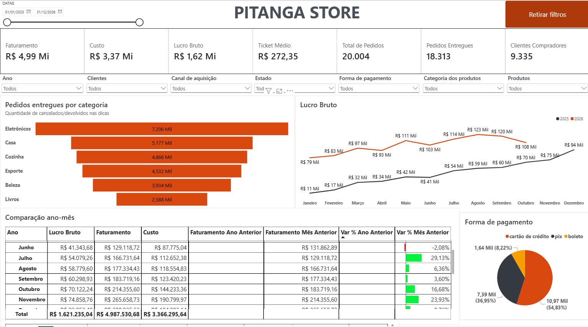

# Análise de Dados: Pitanga Store

Projeto de portfólio com análises do dia a dia de um analista de dados, feitas em **SQL (MySQL)**, **Python (pandas)** e **Power BI**, sobre a base de uma loja online fictícia.

> Os dados são **fictícios**, gerados para estudo. Nomes de clientes e e-mails não correspondem a pessoas reais.

## Ferramentas

- **MySQL 8** (MySQL Workbench): consultas, CTEs, JOINs, funções de janela e limpeza de dados
- **Python / pandas** (Google Colab): limpeza de dados
- **Power BI**: modelagem em esquema estrela, medidas DAX, tabela calendário e dashboard

## A base de dados

| Tabela | Conteúdo |
|---|---|
| `clientes` | 10.000 clientes, com cidade, estado, data de cadastro e canal de aquisição |
| `produtos` | 54 produtos em 6 categorias, com preço de lista e custo |
| `pedidos` | 20.004 pedidos (jan/2025 a out/2026), com dispositivo, forma de pagamento e status |
| `itens_pedido` | os produtos de cada pedido, com quantidade, preço e desconto |
| `clientes_crm_export_bruto` | export "sujo" do CRM, usado na limpeza |

## Análises

| Arquivo | Pergunta |
|---|---|
| [`01_conhecendo_a_base.sql`](sql/01_conhecendo_a_base.sql) | Qual o tamanho da base, o período e a divisão por status? |
| [`02_faturamento_mensal_2026.sql`](sql/02_faturamento_mensal_2026.sql) | Qual o faturamento, o número de pedidos e o ticket médio por mês em 2026? |
| [`03_produtos_e_categorias.sql`](sql/03_produtos_e_categorias.sql) | Quais produtos mais faturam e quais categorias dão mais margem? |
| [`04_limpeza_crm.sql`](sql/04_limpeza_crm.sql) | Como limpar um export de clientes com duplicatas e dados inconsistentes? |
| [`05_canais_de_aquisicao.sql`](sql/05_canais_de_aquisicao.sql) | Qual canal de aquisição traz os melhores clientes? |
| [`06_curva_abc.sql`](sql/06_curva_abc.sql) | Quais produtos são prioridade de estoque (curva ABC)? |
| [`10_melhores_clientes.sql`](sql/10_melhores_clientes.sql) | Quem são os melhores clientes para receber um brinde? |
| [`04_limpeza_crm.ipynb`](notebooks/04_limpeza_crm.ipynb) | A mesma limpeza do export do CRM, feita em Python (pandas) |

## Principais resultados

- **Crescimento:** de janeiro a outubro de 2026, a loja faturou **R$ 3,14 milhões**, **142,7% a mais** que no mesmo período de 2025.
- **Faturar não é o mesmo que lucrar:** Eletrônicos é a categoria que mais vende (35,1% da receita), mas tem a **menor margem bruta (21,5%)**. Casa fatura menos da metade e deixa quase o mesmo lucro bruto em reais (R$ 223 mil contra R$ 237 mil).
- **Melhor canal:** o Google Ads traz mais clientes, mas os clientes que chegam por **Indicação** gastam cerca de **60% a mais** (R$ 928,85 contra R$ 579,18) e **65,5% voltam a comprar**.
- **Curva ABC:** 25 dos 54 produtos (46%) respondem por 79,1% da receita. A regra "20/80" não se aplica a este catálogo.
- **Qualidade dos dados:** o export do CRM tinha 2.535 linhas. Depois de remover 143 duplicatas e 1 linha de teste e padronizar cidades, datas e canais, sobraram **2.391 clientes únicos**, dos quais 95 sem e-mail.
- **Cancelamentos e devoluções:** 5,5% dos pedidos são cancelados e 2,9% devolvidos.

## Dashboard (Power BI)

**[Abrir o dashboard interativo](https://app.powerbi.com/view?r=eyJrIjoiYjRjMWNjYmItZjVlMS00MjVhLTgxNTItZmYwNTdhNjFhM2MxIiwidCI6ImM5NDM3Y2M0LWJkZWYtNDZmMi04ZmRiLTY4OGUzZTMxODhhMCJ9)**: dá para usar os filtros direto no navegador, sem instalar nada.

O dashboard traz os KPIs principais (faturamento, custo, lucro bruto, ticket médio, pedidos e clientes), a evolução mensal comparando 2025 e 2026, a comparação mês a mês e ano a ano com formatação condicional, e as análises por categoria, produto, forma de pagamento, dispositivo e cliente.

Destaques técnicos:
- **tabela calendário** criada em DAX, com comparações por `SAMEPERIODLASTYEAR` e `DATEADD` limitadas aos dias que já têm vendas;
- medidas de faturamento, custo (`RELATED`), lucro bruto, margem, ticket médio e taxas de cancelamento e devolução.

## Autor

**Lucas Gabriel Penha**: [LinkedIn](https://www.linkedin.com/in/lucas-gabriel-9719a83a7/)
